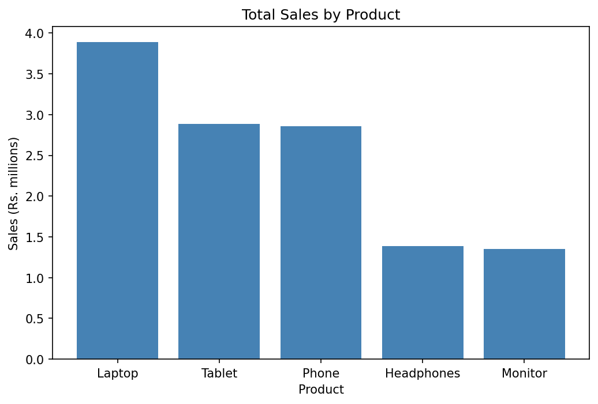
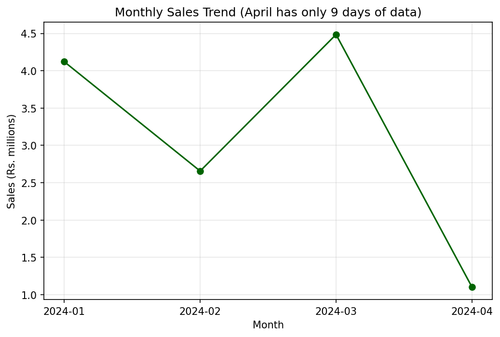
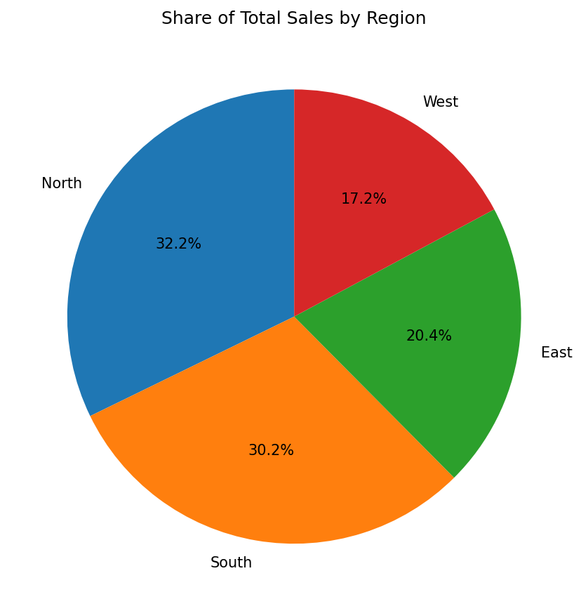
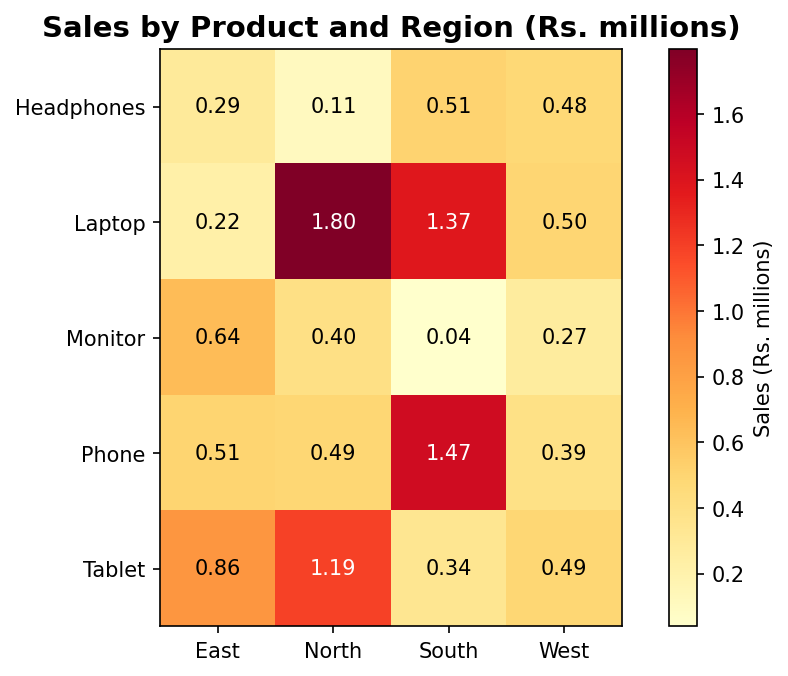
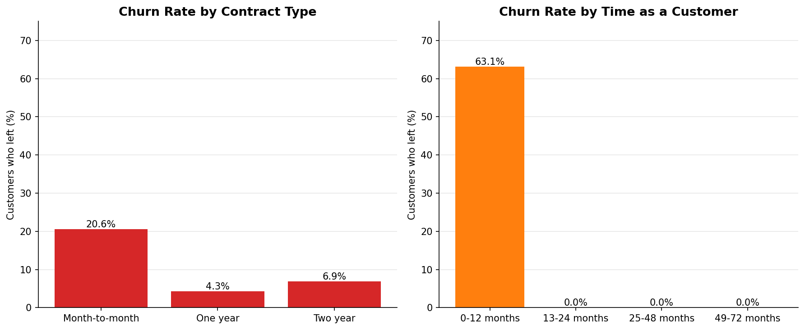

# Customer Sales Analysis

## Project Overview
This project analyses customer purchasing patterns and sales performance using Python and pandas. It combines two datasets (sales orders and customer information), then uses grouping, a data merge and pivot tables to answer business questions: who the most valuable customers are, which products and regions sell best, how sales change by month, and how customer retention can be improved. Results are shown in 5 charts and a written report with business recommendations.

## Setup Instructions
1. Install Python 3 from python.org (or use Google Colab, which needs no installation).
2. Install the libraries with: pip install -r requirements.txt
3. Open customer_analysis.ipynb in Google Colab (colab.research.google.com).
4. Run the first cell. When it asks for files, upload customer_data.csv and sales_data.csv together.
5. Run the remaining cells in order. The 5 charts are created and saved in a charts folder.

## Code Structure
- customer_analysis.ipynb : the full analysis notebook (load, clean, merge, analyse, visualise)
- sales_data.csv : sales orders (100 rows, 7 columns)
- customer_data.csv : customer information and churn status (500 rows, 9 columns)
- analysis_report.pdf : the complete written report with insights and recommendations
- requirements.txt : the libraries needed (pandas, matplotlib)
- charts/ : the 5 charts created by the notebook

The notebook has 4 steps: (1) load and explore, (2) clean and join, (3) analysis with aggregations and pivot tables, (4) charts.

## Visual Documentation
Bar chart: total sales by product

Line chart: monthly sales trend

Pie chart: share of sales by region

Heatmap (from a pivot table): sales by product and region

Bar charts: customer churn rate by contract type and by time as a customer

## Technical Details
- Data loading and exploration: pd.read_csv, head, shape, dtypes, isnull and duplicated.
- Cleaning: string methods (strip, title, str.extract) to tidy text; pd.to_datetime to convert dates; dt accessor to extract year, month, month name and quarter; pd.cut to create an order-size column; dropna and drop_duplicates.
- Merging: the sales file uses IDs like CUST001 and the customer file uses IDs like C00001, so no IDs match exactly. The number inside each ID was extracted and used as the join key, followed by a left merge (many-to-one). This is an assumption: it treats CUST001 and C00001 as the same customer.
- Aggregations (groupby with agg): sales by product, by region, by month and by contract type, plus a top-5 customer ranking.
- Pivot tables (pd.pivot_table): sales by product and region, and sales by region and quarter. Churn rates were calculated by contract type and by tenure group.
- Visualisation: matplotlib (bar, line, pie, heatmap and grouped bar charts).

## Testing Evidence
- Both files were checked: 0 missing values and 0 duplicate rows in each.
- Merge check: 100 sales rows joined with the customer data gave 100 merged rows, with 0 sales rows without a customer match.
- The totals agree across groupings: sales by product, by region and by month all add up to Rs.12,365,048.
- The pivot table totals match the groupby totals.
- The notebook runs from top to bottom without errors, and all 5 charts are created.

## Key Findings
- Total sales: Rs.12,365,048 from 100 orders (average Rs.123,650 per order).
- Laptop is the best-selling product (31.5% of sales). North (32.2%) and South (30.2%) are the strongest regions.
- The West region has 26 orders but the smallest average order (Rs.81,689).
- March was the best month. April has only 9 days of data.
- The top 10 orders make 27.1% of sales.
- Overall churn is 10.6%. Month-to-month contracts churn at 20.6% against 4.3% for one-year contracts.
- 63.1% of customers in their first 12 months left, while no customer with more than 12 months of tenure left.
- Customers who left had much smaller orders (average Rs.53,163 against Rs.131,482).

## Business Recommendations
1. Build an onboarding programme for first-year customers, because churn is concentrated in the first 12 months.
2. Offer incentives to move month-to-month customers to one-year contracts.
3. Protect the high-value accounts that bring a large share of sales.
4. Focus Laptop promotion in the North and South, and Phone promotion in the South.
5. Raise the order value in the West region with bundles and upselling.
6. Collect multi-item order data (to measure cross-selling) and at least a full year of sales data.

The full analysis, tables and limitations are in analysis_report.pdf.

## What I Learned
I learned how to group and aggregate data, filter with conditions, clean text and dates with pandas, merge two datasets, build pivot tables, and turn the results into charts and business recommendations. I also learned to check data carefully, because the two files used different customer ID formats.
